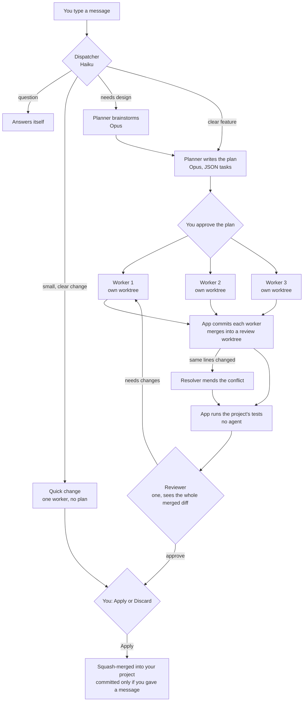
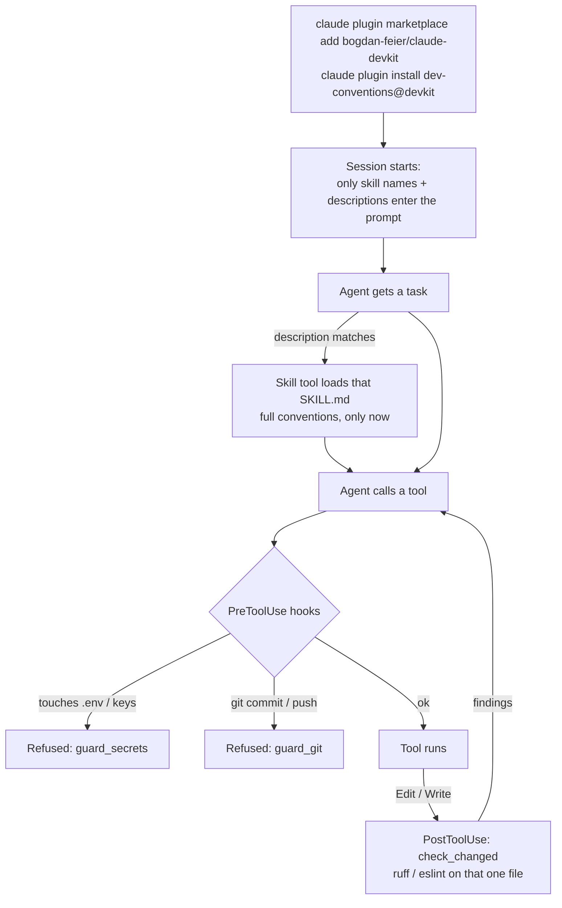

# Demo — Agent Console (Fri 20 Nov)

## 1. Today: build the app with Agent Console only

Use a clean folder so every line comes from the app. `demo-fresh` was started from PyCharm
(it has `.idea` commits and a sample script), and its runs used older builds.

```bash
mkdir ~/demo-habits && cd ~/demo-habits && git init && echo "# Habits" > README.md && git add . && git commit -m "Start"
```

In Agent Console: open `~/demo-habits`, pick the **Balanced** preset and 3 workers, and turn
on "any command". Then send the prompt below. It is the one that built `demo-fresh` for **$0.83**
with all 3 reviews approving first time.

> Build a small habit tracker web app in Python, managed with uv.
>
> Backend: a FastAPI service that stores habits in SQLite. A habit has a name and the dates it was done. Endpoints to list habits, add a habit, delete a habit, and mark a habit done for today (marking twice on the same day does nothing). Each habit in the list also shows its current streak: how many days in a row it has been done, up to today.
>
> Frontend: one plain HTML page served by the backend, with no framework and no build step. It lists the habits with their streaks, has a box to add a habit, a "Done today" button and a delete button for each, and refreshes the list after every action.
>
> Tests: pytest tests for the streak calculation (no days, one day, a gap, done today versus not yet today) and for every endpoint, using a temporary database.
>
> Keep it simple and readable. Add a short README that says how to install and run it and how to run the tests.

Then click **Apply** with a commit message. Optionally add one or two small features (stats endpoint, a CLI) so the app looks
richer tomorrow. Write down the cost in the header after each round.

**Rehearse tomorrow's prompt once today** in a copy, then **Discard** so it stays new for the demo:

```bash
cp -R ~/demo-habits ~/demo-habits-rehearsal
```

## 2. Tomorrow's demo prompt

Show the three ways a message can go, from cheapest to the full team.

| Step | Message | What it shows | Expected cost |
|---|---|---|---|
| Ask | `How is the current streak calculated, and where?` | The dispatcher (Haiku) answers itself, with no plan or workers | ~$0.003 |
| Quick | `Change the page title to "My habits".` | Small, clear change → goes straight to one worker, no plan | ~$0.03 |
| Plan | the feature below | Planner → 3 parallel workers in worktrees → merge → tests → review → Apply | ~$0.5–2 (measure it today) |

**The feature: weekly goals.** It naturally splits into backend, page and CLI, so three workers run at once.
Some files may overlap, which can trigger the resolver.

> Add weekly goals. A habit can have a goal of 1 to 7 days a week, or no goal (the default).
>
> API: set or clear a habit's goal, and each habit in the list shows how many days it was done this week (weeks start on Monday) next to its goal.
>
> Page: a small progress bar per habit for this week ("3 / 5"), and a way to set the goal.
>
> CLI: `goal <habit id> <n>` sets it, `goal <habit id> none` clears it.
>
> Tests for the week counting (Monday start, a day last week does not count) and for every new endpoint.
>
> Then start the app, add a habit with a goal, mark it done, call the list endpoint and show me the response.

What to point at while it runs:
- the plan card: tasks, files, the check command it offers
- three worker cards working in parallel, each in its own git worktree
- refused commands showing on the review, with **Allow** buttons
- the check command running on the merged result before the reviewer starts
- the reviewer's verdict, then the Changes window showing the diff per file
- the sandbox: the worker starts the server and calls it
- the cost in the header, per round and for the whole run

**Plan B if it goes wrong live:** open the rehearsal run from the **Runs** window. Everything is replayed from
`runs/<id>.jsonl`.

## 3. Observations and numbers

All taken from the 14 saved runs in `~/Library/Application Support/dev.agentconsole.desktop/runs/`.
These are different apps of different sizes, so treat them as a trend, not a lab benchmark.

> **Cost caveat (found while preparing this):** when a session is resumed (`--resume`), Claude Code's
> `total_cost_usd` includes everything that session spent before. I checked this with three Haiku
> calls: $0.131, then $0.1485, then $0.157. The app adds those values up, so its header overstates
> runs where agents were resumed. The numbers below are corrected: each value counts only what it
> added since the previous one.

### Cost of building an app from scratch

| Run | When | Team | Real cost (app showed) | Planner share | Reviews | Refused cmds |
|---|---|---|---|---|---|---|
| Glovebox (car-document reminders), 33 messages | Mon 16 | Opus planner, Sonnet workers | **$4.36** ($27.45) | 62% | 15 of 17 "needs changes" | 29 |
| Tic-tac-toe, layered FastAPI | Wed 18 AM | Opus planner, Sonnet workers | **$2.76** ($5.51) | 60% | 3 of 7 "needs changes" | 14 |
| Habit tracker (`demo-fresh`) | Wed 18 PM | Opus planner, **Haiku workers** | **$0.83** ($1.63) | 80% | 0 of 3 "needs changes" | 6 |

### Small features on an existing app

| Request | Cost |
|---|---|
| Quick change, one worker, no plan (Glovebox env var) | **$0.03** |
| Logo colour blue → red (another project) | $0.16 |
| Endpoint: longest streak ever, with a test | $0.23 |
| Endpoint: longest current streak, no tests | $0.24 |
| Endpoint: total done days, with tests (reviewer sent it back once) | $0.35 |
| A whole session of 11 requests on the habit tracker (health check, CLI, page polish, stats…) | $2.11 |

### What I learned

1. **The planner is most of the cost.** It takes 60–80% of a build. Workers on Haiku cost cents: all
   three habit-tracker workers together cost **$0.04**. That is why the fixes went into the planner. It now
   skips research when the request already names its changes, thinks at low effort when files are named,
   and marks only hard tasks to run on Sonnet.
2. **Cheaper workers did not make it worse.** The habit tracker on Haiku workers passed review 3/3 the first time.
   Earlier builds on Sonnet workers were sent back several times. The prompt was more precise too, see point 4.
3. **Caching does most of the work.** In the habit-tracker build, 1.2M tokens were read from the cache and only 112 were
   fresh input. Workers, the reviewer and the resolver use the 5-minute cache, which costs 1.25× to write instead of 2×.
   All agents share the same system prompt, so a cache one agent writes is read by the others.
4. **A precise prompt saves money twice.** Clear requests went through one review. Vague ones went
   through many review loops (Glovebox: 15 "needs changes").
5. **Refused commands were the main friction.** There were 29 in the first big run. Now they are listed on the
   review with an Allow button, and "any command" runs in a sandbox limited to the project.
6. **Quick changes are almost free.** Routing small, clear changes past the planner is the biggest
   cost saving per message.
7. **Don't trust a cost number you haven't checked.** The app's own cost display was inflated up to 6×
   by the resumed-session behaviour above.

## 4. How the app works

A Tauri desktop app with a Rust engine. It drives the `claude` CLI headless, one process per agent.



How to explain each part:
- **Each agent is a separate `claude -p` process.** Its role comes from flags: `--model`, `--effort`, `--tools`,
  `--append-system-prompt` (the role instructions from `config.rs`), `--json-schema` (so the plan is
  structured), `--max-turns` and `--max-budget-usd`.
- **Git is handled by code, not by the model.** `worktrees.rs` creates the worktrees, commits, merges, applies
  and cleans up. Workers never commit.
- **The UI is fed by events.** Each agent's `stream-json` output becomes events that draw the cards. They are
  also saved to disk, so a run can be reopened and usually continued after a restart.
- **Safety:**
  - `--permission-mode dontAsk` means anything not allowed is refused, and the refusal is shown to you.
  - "Any command" runs inside the macOS sandbox, limited to the agent's folder.
  - Nothing reaches your project until you click Apply.

## 5. My plugin: `dev-conventions` (marketplace `bogdan-feier/claude-devkit`)

It packages team conventions as **skills** and enforces the important ones with **hooks**. You install it once
and `git pull` updates it for everyone.

- **Skills** (loaded only when relevant): `layered-service`, `langgraph-workflow`, `react-feature`,
  `pr-ready`, `minimal-change`
- **Hooks:**
  - `guard_secrets` blocks reading `.env`, keys and credential files
  - `guard_git` blocks `git commit` and `git push` by the agent
  - `check_changed` lints the one file that was just edited and sends the findings back to the agent



**How it plugs into Agent Console:**
- In Settings you pick the plugin folders. The planner, workers and reviewer then start with
  `--setting-sources project,local --plugin-dir <folder>`, so they get only the plugins you listed and not
  everything installed on your machine.
- The planner sees the skills too, so it plans *by* the conventions (for example, a layered architecture for the
  tic-tac-toe run).
- `guard_git` fits the app's model. Agents never commit; the app does it in Rust, which the hook doesn't see.
- Skills cost almost nothing until used, because only the one-line descriptions sit in the prompt.

**One line for the team lead:** "Conventions live in a repo as a plugin. Skills teach the agent and hooks enforce
the rules it must not break. Agent Console loads exactly the plugins I choose into each agent."
